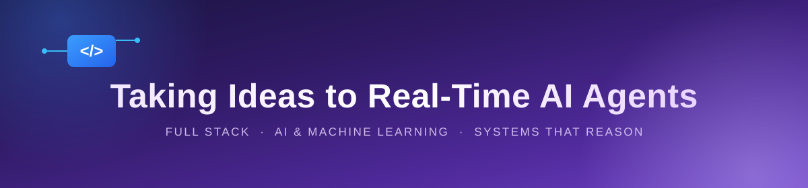

### Building at the intersection of Full Stack, AI, and Optimization

---

### About Me

- Penultimate-year **Bachelor of Software Engineering** student at Deakin University, Melbourne - specialising in Full Stack Web Development and AI
- Currently **Project Lead** for **AquaBlend**, leading four streams (MILP Optimisation, AI & Analysis, Data Science, App & Delivery)
- Exploring **LLM internals, fine-tuning, and reasoning distillation** as a side technical deep-dive
- Freelance UI/UX work, and actively looking for internship opportunities
- Robotics background - trained an autonomous Duckiebot (`mybot002437`) for lane following and intersection handling

---

### Tech Stack

<table border="0" cellspacing="0" cellpadding="12">
<tr>
<td valign="top">

**Languages**
  
     

</td>
<td valign="top">

**Frameworks & Web**
  
  

</td>
</tr>
<tr>
<td valign="top">

**AI / ML / LLMs**
  
     

</td>
<td valign="top">

**Cloud & Infra**
  
  

</td>
</tr>
<tr>
<td valign="top" colspan="2">

**Tools**
  
   

</td>
</tr>
</table>

---

### Featured Projects

| Project | Description |
|---|---|
| **AquaBlend** | Led four-stream capstone project - MILP network formulation, PostgreSQL/Supabase data architecture, and AI/analysis pipeline |
| **EVAT** | Rasa NLU pipeline with DIETClassifier, TEDPolicy, and a RAG layer - led 20+ contributors |
| **Reasoning Distillation Fine-Tuning** | Distilling chain-of-thought reasoning from a larger LLM into a small Qwen 1.5B model, trained on free Colab/Kaggle T4 GPUs |
| **NodeMap** | AST-based codebase visualisation tool with Tarjan's SCC cycle detection, React Flow, full-stack, deployed |
| **BugTrace** | VS Code extension for error fingerprinting with Jira integration |
| **GridRace** | Hackathon project ~ real-time energy usage social app using AEMO NEMWeb data, TimescaleDB, Redis, Socket.io |
| **Sentinel-X** | ESP32-WROVER hardware hackathon project ~ FSM-based sensor system with MicroPython and ntfy.sh notifications |

---

📫 Reach me at **[bhullararchit@gmail.com](mailto:bhullararchit@gmail.com)** · 🌐 **[architbhullar.com](https://architbhullar.com/)**

